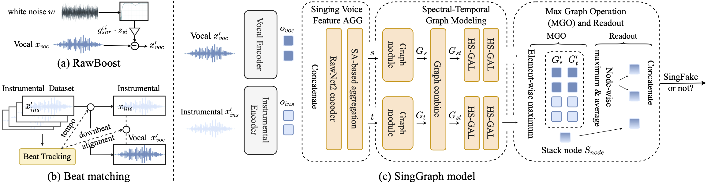

<div align="center">

# Singing Voice Deepfake Detection

**SingGraph and our follow-up work on singing voice deepfake (SingFake) detection**

[Papers](#papers) · [Datasets](#datasets) · [Citation](#citation) · [Contact](#contact)

</div>

> **Research line**
>
> - [SingGraph](#singing-voice-graph-modeling-for-singfake-detection) is the first method proposed specifically for singing voice deepfake detection.
> - [Instrumental Music Analysis](#how-does-instrumental-music-help-singfake-detection) studies what detectors learn from accompaniment.
> - [Sing-HiResNet](#joint-fullband-subband-modeling-for-high-resolution-singfake-detection) extends detection to high-resolution audio.

## Papers

### Singing Voice Graph Modeling for SingFake Detection

[](https://doi.org/10.21437/Interspeech.2024-1185)
[](https://arxiv.org/abs/2406.03111)
[](main.py)

Xuanjun Chen, Haibin Wu, Jyh-Shing Roger Jang, Hung-yi Lee · Lightning Talk at SLT 2024

- **SingGraph:** The first method proposed specifically for SingFake detection, combining MERT for pitch and rhythm with wav2vec 2.0 for lyrics through graph modeling.
- **Music-informed augmentation:** Uses RawBoost and beat matching for singing voice augmentation.
- **Result:** Improves EER on the SingFake dataset by 13.2% for seen singers, 24.3% for unseen singers, and 37.1% for unseen singers with different codecs, relative to the previous state of the art.

<p align="center">
  
</p>

**Code:** This repository contains the official SingGraph code. Set the dataset and model checkpoint paths in `utils/SingGraph.conf`, then run:

```bash
pip install -r requirements.txt
bash run.sh
```

---

### How Does Instrumental Music Help SingFake Detection?

[](https://doi.org/10.1109/ICASSP55912.2026.11460829)
[](https://arxiv.org/abs/2509.14675)

Xuanjun Chen, Chia-Yu Hu, I-Ming Lin, Yi-Cheng Lin, I-Hsiang Chiu, You Zhang, Sung-Feng Huang, Yi-Hsuan Yang, Haibin Wu, Hung-yi Lee, Jyh-Shing Roger Jang

- **Behavioral analysis:** Tests different backbones, unpaired instrumental tracks, and frequency subbands.
- **Key finding:** Instrumental accompaniment acts mainly as data augmentation rather than providing intrinsic cues such as rhythm or harmony.
- **Representational analysis:** Fine-tuning increases reliance on shallow speaker features while reducing sensitivity to content, paralinguistic, and semantic information.

---

### Joint Fullband-Subband Modeling for High-Resolution SingFake Detection

[](https://doi.org/10.21437/Interspeech.2026-1614)
[](https://arxiv.org/abs/2604.04841)

Xuanjun Chen\*, Chia-Yu Hu\*, Sung-Feng Huang, Haibin Wu, Hung-yi Lee, Jyh-Shing Roger Jang

- **High-resolution analysis:** Presents the first systematic analysis of 44.1 kHz audio for SingFake detection.
- **Sing-HiResNet:** Combines a fullband model for global context with subband experts for fine-grained synthesis artifacts.
- **Result:** Shows that high-frequency subbands provide essential complementary cues, significantly outperforming 16 kHz models on WildSVDD.

## Datasets

| Dataset | Used by | Access |
|---|---|---|
| [SingFake](https://singfake.org/) | SingGraph, Instrumental Music Analysis | Not open source because of copyright. Please follow the instructions in the SingFake paper to download it. |
| [WildSVDD](https://arxiv.org/abs/2405.05244) | Sing-HiResNet | Because of copyright, the data are re-collected following the official protocols. |

## Citation

If you find our work useful, please consider citing:

```bibtex
@inproceedings{chen24o_interspeech,
  title     = {Singing Voice Graph Modeling for SingFake Detection},
  author    = {Chen, Xuanjun and Wu, Haibin and Jang, Jyh-Shing Roger and Lee, Hung-yi},
  booktitle = {{INTERSPEECH 2024}},
  pages     = {4843--4847},
  year      = {2024},
  doi       = {10.21437/Interspeech.2024-1185}
}

@inproceedings{chen2026how,
  title     = {How Does Instrumental Music Help {SingFake} Detection?},
  author    = {Chen, Xuanjun and Hu, Chia-Yu and Lin, I-Ming and Lin, Yi-Cheng and Chiu, I-Hsiang and Zhang, You and Huang, Sung-Feng and Yang, Yi-Hsuan and Wu, Haibin and Lee, Hung-yi and Jang, Jyh-Shing Roger},
  booktitle = {ICASSP 2026 - IEEE International Conference on Acoustics, Speech and Signal Processing},
  pages     = {19072--19076},
  year      = {2026},
  doi       = {10.1109/ICASSP55912.2026.11460829}
}

@inproceedings{chen2026joint,
  title     = {Joint Fullband-Subband Modeling for High-Resolution {SingFake} Detection},
  author    = {Chen, Xuanjun and Hu, Chia-Yu and Huang, Sung-Feng and Wu, Haibin and Lee, Hung-yi and Jang, Jyh-Shing Roger},
  booktitle = {{INTERSPEECH 2026}},
  year      = {2026},
  doi       = {10.21437/Interspeech.2026-1614}
}
```

## Contact

If you have any questions, please contact d12942018@ntu.edu.tw.
